# XGBoost Model Performance & Accuracy Report

> [!NOTE]
> **Evaluation Benchmark**: Walk-forward & out-of-sample test splits on 1-minute FX datasets.
> **Targets**: Realised Volatility (`vol`) & Mean Bid-Ask Spread (`spread`) over forward horizons $H \in \{5, 15, 30\}$ minutes.
> **Run settings**: `python scripts/evaluate_xgboost.py --target both --horizons 5,15,30 --max-trees 300 --cv 3 --cv-days 3 --cv-trees 300`.
> Trees were capped at 300 per model to keep the run short; an uncapped run early-stops near 2,000 trees
> (vol 5m: RMSE 0.5049 vs 0.5104 here), so these scores are slightly conservative.
> The Buy/Sell direction model was not evaluated in this run (`--include-direction`).

## 1. Executive Summary & Overall Accuracy

| Target | Horizon | Test Rows | Trees | RMSE (log) | Baseline RMSE | **RMSE Imprv %** | MAE (log) | $R^2$ | RMSE (bp) | Baseline (bp) | **Imprv % (bp)** | Dir Acc |
|---|---|---|---|---|---|---|---|---|---|---|---|---|
| **VOL** | 5m | 170,741 | 300 | 0.5104 | 0.6239 | **+18.19%** | 0.3831 | 0.707 | 0.887 bp | 1.022 bp | **+13.23%** | 73.1% |
| **VOL** | 15m | 162,693 | 300 | 0.3379 | 0.4328 | **+21.93%** | 0.2488 | 0.802 | 1.244 bp | 1.518 bp | **+18.04%** | 73.3% |
| **VOL** | 30m | 155,153 | 300 | 0.2743 | 0.3768 | **+27.20%** | 0.2019 | 0.830 | 1.599 bp | 2.065 bp | **+22.59%** | 74.0% |
| **SPREAD** | 5m | 403,116 | 300 | 0.1485 | 0.3341 | **+55.56%** | 0.1005 | 0.970 | 0.387 bp | 0.897 bp | **+56.87%** | 66.8% |
| **SPREAD** | 15m | 392,635 | 300 | 0.1317 | 0.3211 | **+59.00%** | 0.0866 | 0.975 | 0.360 bp | 0.823 bp | **+56.21%** | 67.3% |
| **SPREAD** | 30m | 381,573 | 300 | 0.1254 | 0.3228 | **+61.14%** | 0.0802 | 0.976 | 0.309 bp | 0.776 bp | **+60.21%** | 68.9% |

> [!TIP]
> - **RMSE (log)**: Represents relative/multiplicative error ($~0.25$ indicates approx 25% relative spread/volatility prediction accuracy).
> - **RMSE (bp)**: Represents physical pricing deviation in basis points ($0.01\% = 1$ bp).
> - **Imprv %**: Relative percentage reduction in RMSE compared to the standard 60-minute trailing rolling benchmark.

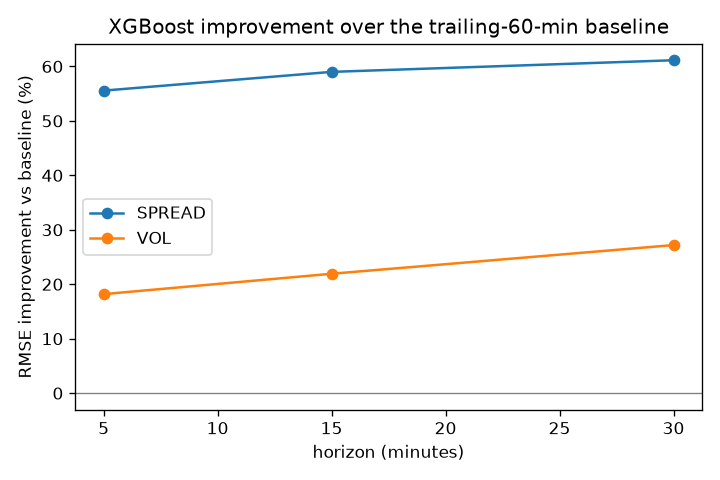

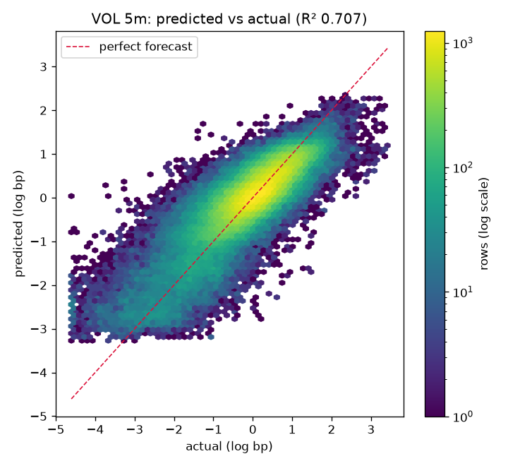

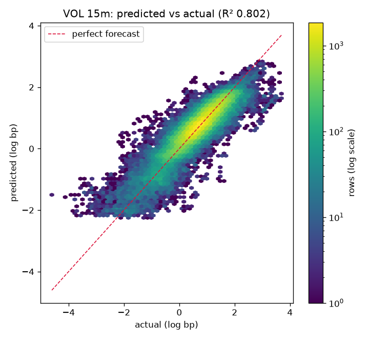

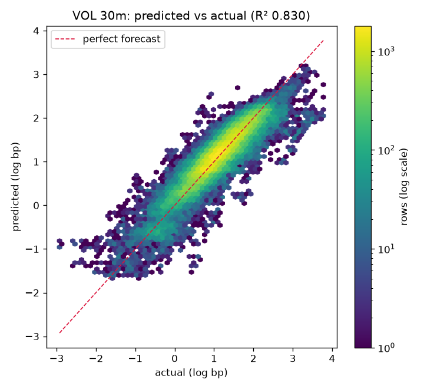

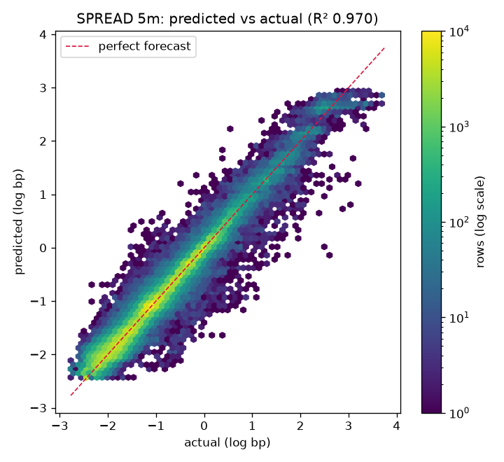

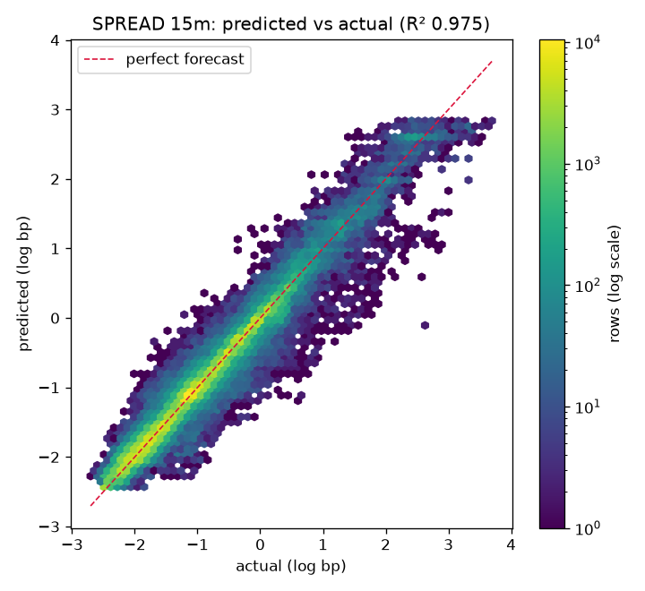

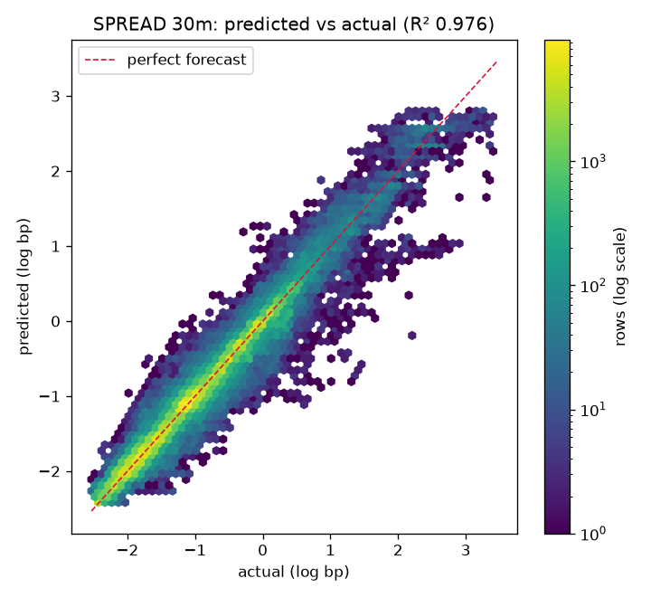

## 2. Accuracy Breakdown by Currency Pair

### Target: `VOL` (5m Horizon)

| Pair | Rows | XGBoost RMSE | Baseline RMSE | **Imprv %** | XGBoost MAE | $R^2$ | RMSE (bp) | Imprv % (bp) |
|---|---|---|---|---|---|---|---|---|
| **AUDUSD** | 8,294 | 0.4257 | 0.5127 | **+16.96%** | 0.3286 | 0.420 | 1.036 bp | +12.75% |
| **EURGBP** | 8,170 | 0.4473 | 0.5608 | **+20.25%** | 0.3473 | 0.525 | 0.437 bp | +20.56% |
| **EURJPY** | 8,580 | 0.4399 | 0.5220 | **+15.73%** | 0.3392 | 0.378 | 0.502 bp | +11.51% |
| **EURSGD** | 8,498 | 0.4497 | 0.5450 | **+17.48%** | 0.3469 | 0.311 | 0.450 bp | +16.19% |
| **EURUSD** | 8,558 | 0.4861 | 0.5733 | **+15.20%** | 0.3574 | 0.486 | 0.667 bp | +10.07% |
| **GBPJPY** | 8,533 | 0.4570 | 0.5500 | **+16.91%** | 0.3439 | 0.371 | 0.597 bp | +13.58% |
| **GBPUSD** | 8,423 | 0.4677 | 0.5594 | **+16.39%** | 0.3537 | 0.481 | 0.764 bp | +11.69% |
| **NZDUSD** | 8,394 | 0.4392 | 0.5533 | **+20.62%** | 0.3324 | 0.419 | 1.239 bp | +15.52% |
| **SGDJPY** | 8,451 | 0.4789 | 0.5708 | **+16.11%** | 0.3621 | 0.245 | 0.520 bp | +14.60% |
| **USDCAD** | 8,330 | 0.4856 | 0.5711 | **+14.98%** | 0.3663 | 0.450 | 0.614 bp | +9.92% |
| **USDCHF** | 8,335 | 0.4474 | 0.5499 | **+18.64%** | 0.3416 | 0.468 | 0.988 bp | +13.75% |
| **USDCNH** | 8,406 | 0.5328 | 0.6482 | **+17.81%** | 0.4072 | 0.392 | 0.240 bp | +14.03% |
| **USDHKD** | 5,715 | 0.8309 | 1.0321 | **+19.49%** | 0.6602 | 0.297 | 0.153 bp | +5.59% |
| **USDJPY** | 8,550 | 0.5281 | 0.6336 | **+16.65%** | 0.3827 | 0.410 | 0.706 bp | +12.93% |
| **USDMXN** | 8,454 | 0.5227 | 0.6584 | **+20.62%** | 0.4014 | 0.423 | 0.767 bp | +12.37% |
| **USDNOK** | 8,473 | 0.5252 | 0.6603 | **+20.46%** | 0.4090 | 0.444 | 1.459 bp | +14.46% |
| **USDPLN** | 8,530 | 0.5035 | 0.5957 | **+15.47%** | 0.3847 | 0.386 | 1.171 bp | +10.50% |
| **USDSEK** | 8,522 | 0.4843 | 0.5899 | **+17.91%** | 0.3778 | 0.493 | 1.279 bp | +10.08% |
| **USDSGD** | 8,324 | 0.4904 | 0.5992 | **+18.15%** | 0.3685 | 0.309 | 0.542 bp | +13.53% |
| **USDTRY** | 4,678 | 0.8358 | 1.0576 | **+20.97%** | 0.6346 | 0.317 | 0.291 bp | +21.17% |
| **USDZAR** | 8,523 | 0.5237 | 0.6532 | **+19.82%** | 0.3990 | 0.364 | 1.723 bp | +14.41% |

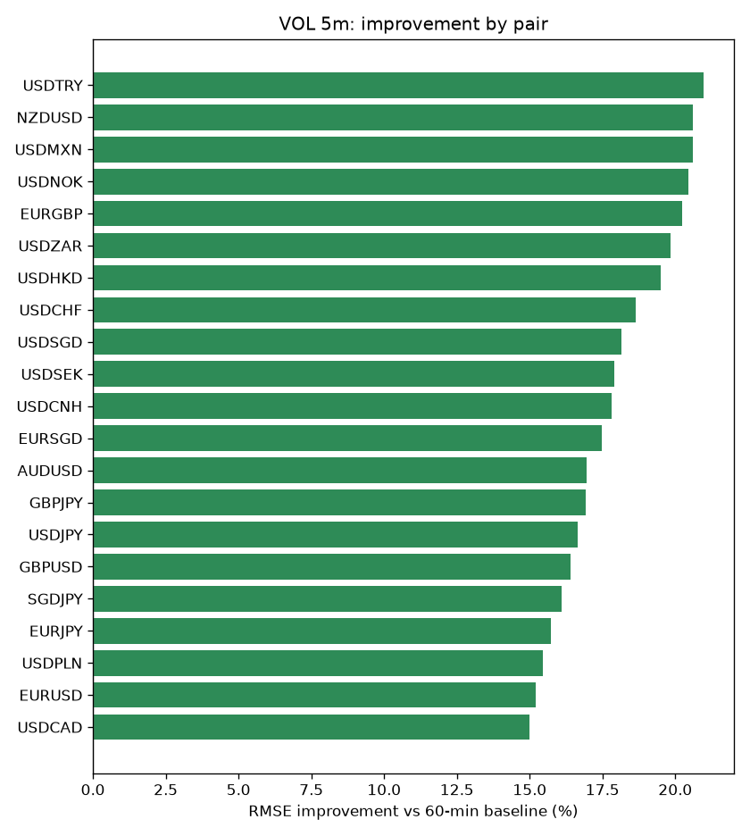

### Target: `VOL` (15m Horizon)

| Pair | Rows | XGBoost RMSE | Baseline RMSE | **Imprv %** | XGBoost MAE | $R^2$ | RMSE (bp) | Imprv % (bp) |
|---|---|---|---|---|---|---|---|---|
| **AUDUSD** | 7,904 | 0.2912 | 0.3819 | **+23.74%** | 0.2158 | 0.557 | 1.544 bp | +17.10% |
| **EURGBP** | 7,677 | 0.2897 | 0.4065 | **+28.72%** | 0.2270 | 0.700 | 0.565 bp | +30.43% |
| **EURJPY** | 8,500 | 0.2893 | 0.3674 | **+21.26%** | 0.2224 | 0.541 | 0.641 bp | +17.79% |
| **EURSGD** | 8,374 | 0.3030 | 0.3929 | **+22.86%** | 0.2268 | 0.469 | 0.590 bp | +21.07% |
| **EURUSD** | 8,478 | 0.3142 | 0.3877 | **+18.96%** | 0.2323 | 0.648 | 0.955 bp | +13.68% |
| **GBPJPY** | 8,402 | 0.2959 | 0.3975 | **+25.55%** | 0.2269 | 0.565 | 0.768 bp | +20.82% |
| **GBPUSD** | 8,209 | 0.2867 | 0.3827 | **+25.09%** | 0.2163 | 0.679 | 1.090 bp | +15.96% |
| **NZDUSD** | 8,089 | 0.2900 | 0.3970 | **+26.95%** | 0.2154 | 0.568 | 1.706 bp | +20.43% |
| **SGDJPY** | 8,301 | 0.3292 | 0.4111 | **+19.92%** | 0.2424 | 0.346 | 0.674 bp | +21.05% |
| **USDCAD** | 8,015 | 0.2873 | 0.3547 | **+19.00%** | 0.2180 | 0.642 | 0.801 bp | +15.54% |
| **USDCHF** | 8,015 | 0.2842 | 0.3830 | **+25.79%** | 0.2129 | 0.638 | 1.427 bp | +17.62% |
| **USDCNH** | 8,175 | 0.3649 | 0.4654 | **+21.59%** | 0.2773 | 0.520 | 0.331 bp | +20.61% |
| **USDHKD** | 3,552 | 0.6109 | 0.7125 | **+14.27%** | 0.4740 | 0.306 | 0.226 bp | +5.54% |
| **USDJPY** | 8,480 | 0.3527 | 0.4330 | **+18.54%** | 0.2493 | 0.503 | 1.015 bp | +17.51% |
| **USDMXN** | 8,274 | 0.3446 | 0.4507 | **+23.55%** | 0.2653 | 0.575 | 0.998 bp | +17.76% |
| **USDNOK** | 8,317 | 0.3617 | 0.4806 | **+24.75%** | 0.2713 | 0.582 | 1.919 bp | +19.89% |
| **USDPLN** | 8,380 | 0.3363 | 0.4104 | **+18.05%** | 0.2585 | 0.542 | 1.640 bp | +13.87% |
| **USDSEK** | 8,372 | 0.3350 | 0.4340 | **+22.81%** | 0.2576 | 0.634 | 1.801 bp | +13.88% |
| **USDSGD** | 8,234 | 0.3200 | 0.4215 | **+24.08%** | 0.2344 | 0.455 | 0.776 bp | +18.59% |
| **USDTRY** | 2,533 | 0.7137 | 0.8621 | **+17.22%** | 0.5461 | 0.356 | 0.474 bp | +23.70% |
| **USDZAR** | 8,412 | 0.3587 | 0.4685 | **+23.45%** | 0.2647 | 0.494 | 2.414 bp | +19.80% |

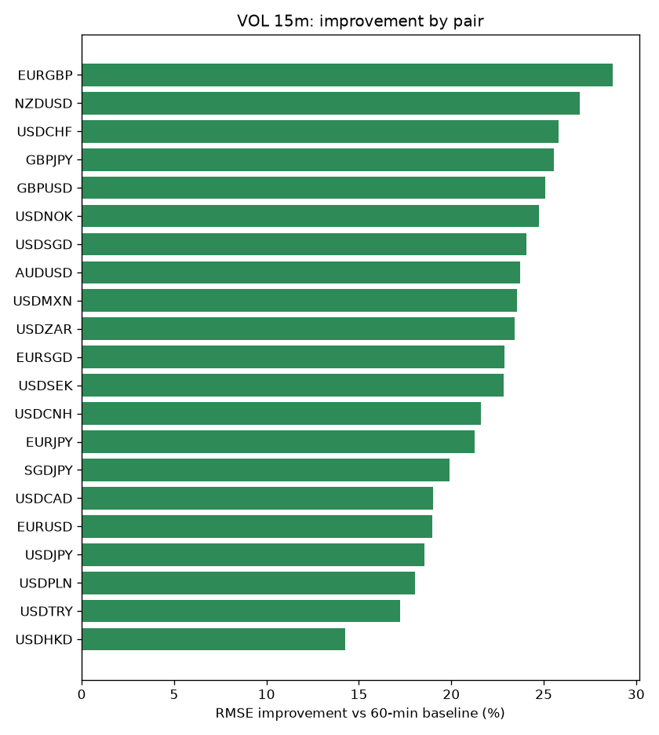

### Target: `VOL` (30m Horizon)

| Pair | Rows | XGBoost RMSE | Baseline RMSE | **Imprv %** | XGBoost MAE | $R^2$ | RMSE (bp) | Imprv % (bp) |
|---|---|---|---|---|---|---|---|---|
| **AUDUSD** | 7,471 | 0.2567 | 0.3607 | **+28.83%** | 0.1856 | 0.583 | 2.058 bp | +21.70% |
| **EURGBP** | 7,187 | 0.2454 | 0.3765 | **+34.81%** | 0.1823 | 0.742 | 0.712 bp | +36.06% |
| **EURJPY** | 8,380 | 0.2409 | 0.3257 | **+26.04%** | 0.1853 | 0.596 | 0.799 bp | +21.49% |
| **EURSGD** | 8,194 | 0.2408 | 0.3477 | **+30.74%** | 0.1797 | 0.572 | 0.666 bp | +27.92% |
| **EURUSD** | 8,358 | 0.2623 | 0.3463 | **+24.26%** | 0.1970 | 0.705 | 1.252 bp | +17.60% |
| **GBPJPY** | 8,217 | 0.2463 | 0.3642 | **+32.38%** | 0.1890 | 0.629 | 0.958 bp | +26.16% |
| **GBPUSD** | 7,952 | 0.2376 | 0.3539 | **+32.87%** | 0.1789 | 0.738 | 1.434 bp | +20.51% |
| **NZDUSD** | 7,782 | 0.2527 | 0.3622 | **+30.25%** | 0.1832 | 0.589 | 2.201 bp | +22.87% |
| **SGDJPY** | 8,092 | 0.2658 | 0.3558 | **+25.31%** | 0.2006 | 0.400 | 0.785 bp | +26.60% |
| **USDCAD** | 7,658 | 0.2272 | 0.3042 | **+25.33%** | 0.1687 | 0.721 | 0.991 bp | +21.55% |
| **USDCHF** | 7,650 | 0.2398 | 0.3467 | **+30.84%** | 0.1751 | 0.685 | 1.862 bp | +21.81% |
| **USDCNH** | 7,915 | 0.3116 | 0.4189 | **+25.61%** | 0.2348 | 0.543 | 0.423 bp | +25.38% |
| **USDHKD** | 1,941 | 0.4808 | 0.5188 | **+7.33%** | 0.3819 | 0.129 | 0.312 bp | +2.06% |
| **USDJPY** | 8,375 | 0.2936 | 0.3769 | **+22.11%** | 0.2119 | 0.525 | 1.331 bp | +20.72% |
| **USDMXN** | 8,032 | 0.2654 | 0.3880 | **+31.60%** | 0.2052 | 0.670 | 1.207 bp | +25.00% |
| **USDNOK** | 8,121 | 0.2921 | 0.4339 | **+32.68%** | 0.2163 | 0.657 | 2.324 bp | +26.32% |
| **USDPLN** | 8,180 | 0.2889 | 0.3672 | **+21.34%** | 0.2197 | 0.589 | 2.113 bp | +17.98% |
| **USDSEK** | 8,158 | 0.2807 | 0.3879 | **+27.64%** | 0.2123 | 0.685 | 2.290 bp | +18.05% |
| **USDSGD** | 8,099 | 0.2678 | 0.3795 | **+29.42%** | 0.1951 | 0.507 | 0.996 bp | +23.06% |
| **USDTRY** | 1,139 | 0.6846 | 0.7592 | **+9.83%** | 0.5233 | 0.338 | 0.638 bp | +17.02% |
| **USDZAR** | 8,252 | 0.2965 | 0.4123 | **+28.10%** | 0.2193 | 0.546 | 3.090 bp | +24.50% |

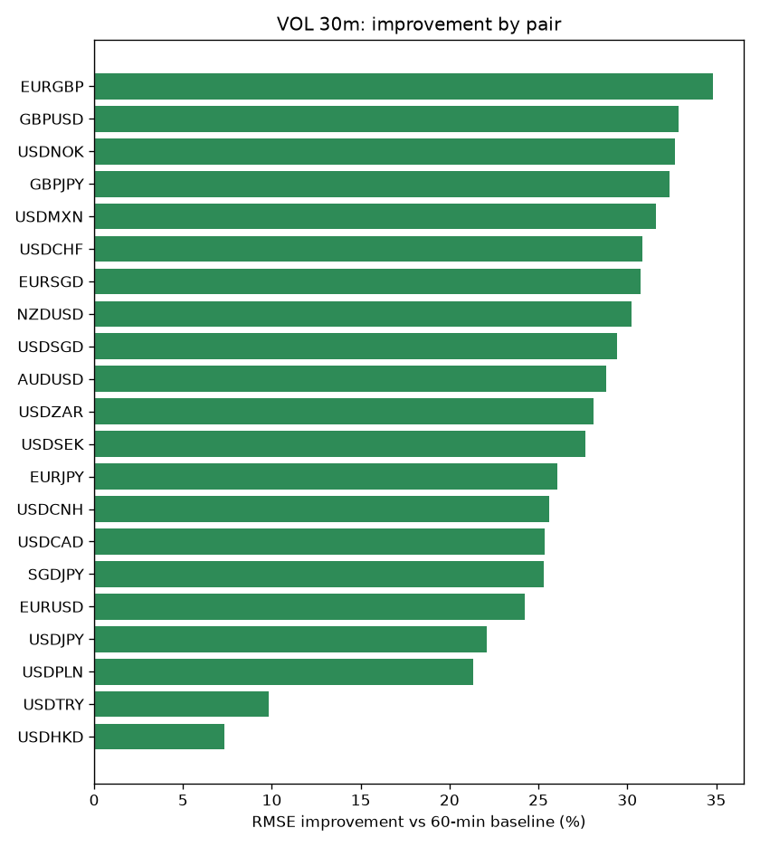

### Target: `SPREAD` (5m Horizon)

| Pair | Rows | XGBoost RMSE | Baseline RMSE | **Imprv %** | XGBoost MAE | $R^2$ | RMSE (bp) | Imprv % (bp) |
|---|---|---|---|---|---|---|---|---|
| **AUDUSD** | 8,294 | 0.0915 | 0.2466 | **+62.91%** | 0.0673 | 0.914 | 0.133 bp | +68.56% |
| **EURGBP** | 8,170 | 0.1222 | 0.2693 | **+54.62%** | 0.0879 | 0.910 | 0.193 bp | +48.56% |
| **EURJPY** | 8,580 | 0.1358 | 0.3493 | **+61.14%** | 0.1008 | 0.926 | 0.093 bp | +76.34% |
| **EURSGD** | 8,498 | 0.0709 | 0.2148 | **+66.99%** | 0.0434 | 0.955 | 0.280 bp | +60.65% |
| **EURUSD** | 85,454 | 0.1645 | 0.3302 | **+50.18%** | 0.1181 | 0.936 | 0.129 bp | +63.84% |
| **GBPJPY** | 8,533 | 0.0897 | 0.3013 | **+70.24%** | 0.0600 | 0.956 | 0.164 bp | +67.33% |
| **GBPUSD** | 8,423 | 0.1183 | 0.2942 | **+59.79%** | 0.0882 | 0.913 | 0.094 bp | +68.75% |
| **NZDUSD** | 8,394 | 0.1020 | 0.2903 | **+64.87%** | 0.0682 | 0.927 | 0.400 bp | +59.77% |
| **SGDJPY** | 8,451 | 0.0646 | 0.2958 | **+78.15%** | 0.0436 | 0.979 | 0.321 bp | +78.05% |
| **USDCAD** | 8,330 | 0.0839 | 0.2121 | **+60.43%** | 0.0580 | 0.932 | 0.094 bp | +60.86% |
| **USDCHF** | 8,335 | 0.0898 | 0.2930 | **+69.35%** | 0.0633 | 0.954 | 0.236 bp | +69.63% |
| **USDCNH** | 8,406 | 0.1005 | 0.2480 | **+59.47%** | 0.0711 | 0.957 | 0.049 bp | +73.94% |
| **USDHKD** | 5,715 | 0.0918 | 0.2681 | **+65.78%** | 0.0658 | 0.966 | 0.029 bp | +78.49% |
| **USDJPY** | 85,534 | 0.1702 | 0.3866 | **+55.97%** | 0.1210 | 0.930 | 0.194 bp | +57.26% |
| **USDMXN** | 8,454 | 0.0980 | 0.2379 | **+58.80%** | 0.0713 | 0.938 | 0.170 bp | +73.79% |
| **USDNOK** | 8,473 | 0.1068 | 0.3121 | **+65.77%** | 0.0683 | 0.969 | 1.314 bp | +53.10% |
| **USDPLN** | 8,530 | 0.1138 | 0.2474 | **+53.99%** | 0.0717 | 0.962 | 0.686 bp | +48.80% |
| **USDSEK** | 8,522 | 0.0927 | 0.2666 | **+65.21%** | 0.0642 | 0.968 | 0.485 bp | +62.89% |
| **USDSGD** | 86,819 | 0.1725 | 0.3699 | **+53.35%** | 0.1159 | 0.921 | 0.451 bp | +58.44% |
| **USDTRY** | 4,678 | 0.1335 | 0.2741 | **+51.29%** | 0.0934 | 0.952 | 0.150 bp | +57.06% |
| **USDZAR** | 8,523 | 0.1102 | 0.2918 | **+62.21%** | 0.0641 | 0.958 | 1.226 bp | +49.35% |

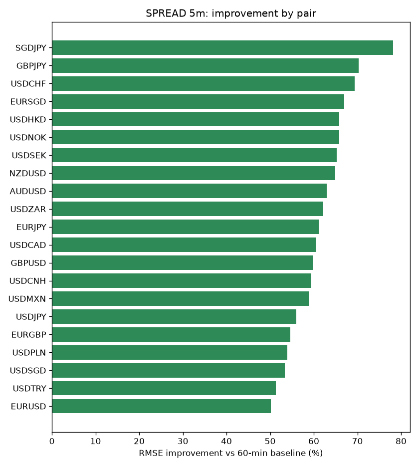

### Target: `SPREAD` (15m Horizon)

| Pair | Rows | XGBoost RMSE | Baseline RMSE | **Imprv %** | XGBoost MAE | $R^2$ | RMSE (bp) | Imprv % (bp) |
|---|---|---|---|---|---|---|---|---|
| **AUDUSD** | 7,904 | 0.0743 | 0.2235 | **+66.74%** | 0.0517 | 0.919 | 0.132 bp | +64.40% |
| **EURGBP** | 7,677 | 0.1088 | 0.2568 | **+57.65%** | 0.0675 | 0.922 | 0.199 bp | +44.01% |
| **EURJPY** | 8,500 | 0.1133 | 0.3409 | **+66.78%** | 0.0794 | 0.939 | 0.093 bp | +73.11% |
| **EURSGD** | 8,374 | 0.0687 | 0.2092 | **+67.17%** | 0.0417 | 0.948 | 0.267 bp | +58.35% |
| **EURUSD** | 84,589 | 0.1348 | 0.3153 | **+57.25%** | 0.0942 | 0.952 | 0.119 bp | +63.07% |
| **GBPJPY** | 8,402 | 0.0749 | 0.2972 | **+74.80%** | 0.0500 | 0.961 | 0.120 bp | +74.14% |
| **GBPUSD** | 8,209 | 0.0923 | 0.2759 | **+66.54%** | 0.0658 | 0.929 | 0.080 bp | +69.49% |
| **NZDUSD** | 8,089 | 0.0732 | 0.2487 | **+70.58%** | 0.0495 | 0.938 | 0.233 bp | +67.97% |
| **SGDJPY** | 8,301 | 0.0594 | 0.2943 | **+79.81%** | 0.0379 | 0.976 | 0.338 bp | +75.42% |
| **USDCAD** | 8,015 | 0.0663 | 0.1687 | **+60.72%** | 0.0430 | 0.941 | 0.069 bp | +61.54% |
| **USDCHF** | 8,015 | 0.0771 | 0.2549 | **+69.77%** | 0.0497 | 0.958 | 0.234 bp | +63.53% |
| **USDCNH** | 8,175 | 0.0870 | 0.2289 | **+61.99%** | 0.0580 | 0.958 | 0.053 bp | +69.00% |
| **USDHKD** | 3,552 | 0.0844 | 0.2717 | **+68.95%** | 0.0610 | 0.972 | 0.039 bp | +72.25% |
| **USDJPY** | 84,648 | 0.1449 | 0.3728 | **+61.13%** | 0.1007 | 0.943 | 0.193 bp | +52.10% |
| **USDMXN** | 8,274 | 0.0952 | 0.2229 | **+57.29%** | 0.0726 | 0.931 | 0.163 bp | +72.63% |
| **USDNOK** | 8,317 | 0.0988 | 0.2957 | **+66.60%** | 0.0642 | 0.969 | 1.033 bp | +57.45% |
| **USDPLN** | 8,380 | 0.1154 | 0.2413 | **+52.17%** | 0.0676 | 0.956 | 0.699 bp | +40.88% |
| **USDSEK** | 8,372 | 0.0863 | 0.2603 | **+66.85%** | 0.0592 | 0.968 | 0.452 bp | +62.98% |
| **USDSGD** | 85,897 | 0.1656 | 0.3562 | **+53.50%** | 0.1102 | 0.918 | 0.466 bp | +54.96% |
| **USDTRY** | 2,533 | 0.1408 | 0.2977 | **+52.71%** | 0.1038 | 0.943 | 0.157 bp | +59.31% |
| **USDZAR** | 8,412 | 0.1155 | 0.2934 | **+60.62%** | 0.0641 | 0.949 | 1.082 bp | +51.73% |

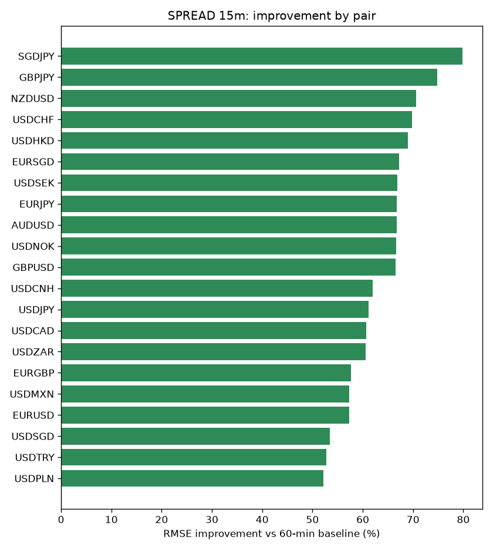

### Target: `SPREAD` (30m Horizon)

| Pair | Rows | XGBoost RMSE | Baseline RMSE | **Imprv %** | XGBoost MAE | $R^2$ | RMSE (bp) | Imprv % (bp) |
|---|---|---|---|---|---|---|---|---|
| **AUDUSD** | 7,471 | 0.0704 | 0.1976 | **+64.36%** | 0.0417 | 0.867 | 0.115 bp | +61.41% |
| **EURGBP** | 7,187 | 0.1337 | 0.2590 | **+48.37%** | 0.0618 | 0.868 | 0.206 bp | +40.50% |
| **EURJPY** | 8,380 | 0.1028 | 0.3492 | **+70.58%** | 0.0705 | 0.940 | 0.092 bp | +72.00% |
| **EURSGD** | 8,194 | 0.0645 | 0.2155 | **+70.09%** | 0.0411 | 0.938 | 0.204 bp | +68.44% |
| **EURUSD** | 83,352 | 0.1242 | 0.3211 | **+61.32%** | 0.0839 | 0.954 | 0.112 bp | +62.84% |
| **GBPJPY** | 8,217 | 0.0645 | 0.2994 | **+78.44%** | 0.0453 | 0.956 | 0.072 bp | +83.57% |
| **GBPUSD** | 7,952 | 0.0813 | 0.2765 | **+70.61%** | 0.0549 | 0.928 | 0.075 bp | +69.92% |
| **NZDUSD** | 7,782 | 0.0610 | 0.2264 | **+73.06%** | 0.0385 | 0.930 | 0.169 bp | +73.70% |
| **SGDJPY** | 8,092 | 0.0551 | 0.2983 | **+81.54%** | 0.0362 | 0.964 | 0.239 bp | +81.25% |
| **USDCAD** | 7,658 | 0.0536 | 0.1359 | **+60.55%** | 0.0367 | 0.940 | 0.048 bp | +65.30% |
| **USDCHF** | 7,650 | 0.0655 | 0.2231 | **+70.62%** | 0.0404 | 0.960 | 0.179 bp | +64.28% |
| **USDCNH** | 7,915 | 0.0758 | 0.2176 | **+65.19%** | 0.0492 | 0.958 | 0.045 bp | +71.46% |
| **USDHKD** | 1,941 | 0.0886 | 0.3037 | **+70.82%** | 0.0577 | 0.967 | 0.048 bp | +69.01% |
| **USDJPY** | 83,368 | 0.1357 | 0.3768 | **+64.00%** | 0.0928 | 0.944 | 0.168 bp | +57.07% |
| **USDMXN** | 8,032 | 0.0896 | 0.2150 | **+58.35%** | 0.0709 | 0.918 | 0.124 bp | +76.58% |
| **USDNOK** | 8,121 | 0.0904 | 0.3028 | **+70.15%** | 0.0586 | 0.967 | 0.761 bp | +65.52% |
| **USDPLN** | 8,180 | 0.1189 | 0.2397 | **+50.37%** | 0.0647 | 0.947 | 0.671 bp | +34.77% |
| **USDSEK** | 8,158 | 0.0777 | 0.2569 | **+69.76%** | 0.0523 | 0.969 | 0.395 bp | +65.23% |
| **USDSGD** | 84,532 | 0.1602 | 0.3546 | **+54.82%** | 0.1070 | 0.914 | 0.407 bp | +59.42% |
| **USDTRY** | 1,139 | 0.1845 | 0.3077 | **+40.04%** | 0.1320 | 0.905 | 0.317 bp | +21.41% |
| **USDZAR** | 8,252 | 0.1280 | 0.3005 | **+57.41%** | 0.0606 | 0.931 | 0.934 bp | +55.57% |

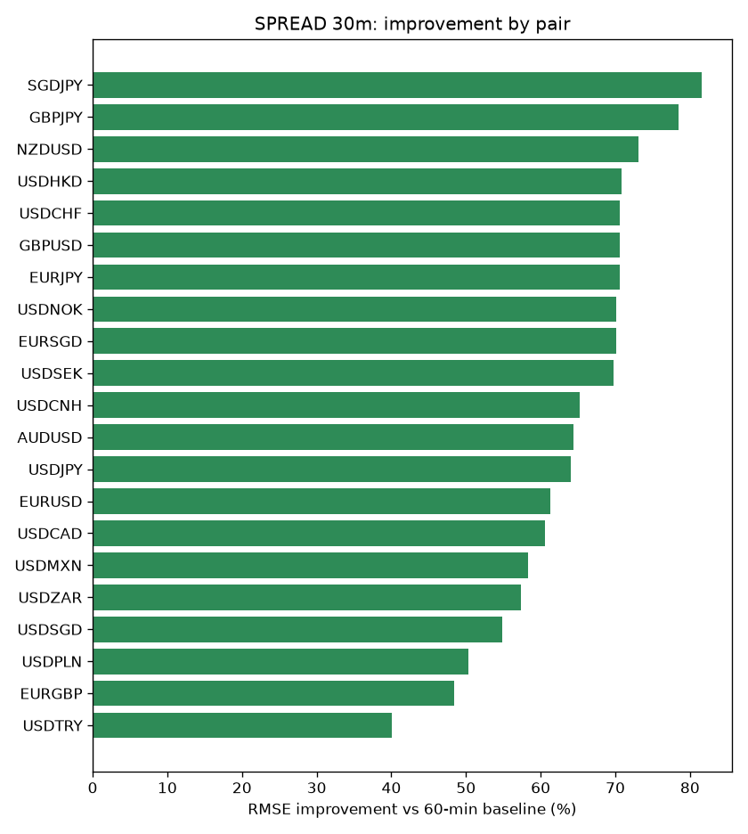

## 3. Spread Accuracy Breakdown by Tenor

Evaluated on 5m prediction horizon:

| Tenor Days | Rows | RMSE (log) | MAE (log) | $R^2$ | RMSE (bp) | MAE (bp) | Imprv % |
|---|---|---|---|---|---|---|---|
| 7d | 25,038 | 0.1656 | 0.1221 | 0.932 | 0.173 bp | 0.039 bp | +52.47% |
| 14d | 26,279 | 0.1737 | 0.1278 | 0.930 | 0.187 bp | 0.045 bp | +51.53% |
| 21d | 25,241 | 0.1886 | 0.1416 | 0.932 | 0.233 bp | 0.058 bp | +53.36% |
| 30d | 25,432 | 0.1778 | 0.1323 | 0.940 | 0.243 bp | 0.054 bp | +56.60% |
| 60d | 26,172 | 0.1629 | 0.1187 | 0.925 | 0.163 bp | 0.046 bp | +51.94% |
| 90d | 26,050 | 0.1607 | 0.1173 | 0.916 | 0.161 bp | 0.048 bp | +52.46% |
| 180d | 25,732 | 0.1353 | 0.0856 | 0.926 | 0.166 bp | 0.050 bp | +54.72% |
| 270d | 26,115 | 0.1751 | 0.1042 | 0.937 | 0.250 bp | 0.075 bp | +53.92% |
| 365d | 25,619 | 0.1758 | 0.1125 | 0.933 | 0.182 bp | 0.071 bp | +50.52% |

## 4. Market Regime Analysis (Calm vs High Volatility)

Evaluates how prediction error behaves across quintiles from quiet/tight market states to extreme volatility spikes.

#### Target: `VOL` (5m Horizon)

| Regime | Rows | Range (log bp) | RMSE | MAE | MedAE | Bias (Mean Residual) |
|---|---|---|---|---|---|---|
| Lowest / Calm | 34,149 | [-4.61, -0.66] | 0.7646 | 0.6076 | 0.5195 | -0.4114 |
| Low | 34,148 | [-0.66, -0.13] | 0.4365 | 0.3399 | 0.2797 | -0.1727 |
| Moderate | 34,148 | [-0.13, 0.25] | 0.3551 | 0.2722 | 0.2204 | -0.0130 |
| High | 34,148 | [0.25, 0.69] | 0.3661 | 0.2881 | 0.2433 | +0.1270 |
| Highest / Spikes | 34,148 | [0.69, 3.42] | 0.5171 | 0.4075 | 0.3448 | +0.3583 |

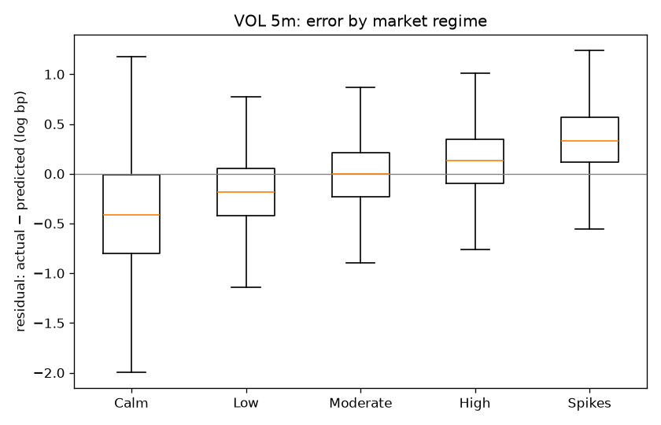

#### Target: `VOL` (15m Horizon)

| Regime | Rows | Range (log bp) | RMSE | MAE | MedAE | Bias (Mean Residual) |
|---|---|---|---|---|---|---|
| Lowest / Calm | 32,539 | [-4.61, 0.18] | 0.4564 | 0.3480 | 0.2809 | -0.1985 |
| Low | 32,538 | [0.18, 0.58] | 0.2949 | 0.2269 | 0.1856 | -0.1075 |
| Moderate | 32,539 | [0.58, 0.90] | 0.2495 | 0.1909 | 0.1526 | -0.0244 |
| High | 32,538 | [0.90, 1.29] | 0.2650 | 0.2054 | 0.1694 | +0.0420 |
| Highest / Spikes | 32,539 | [1.29, 3.69] | 0.3782 | 0.2727 | 0.2035 | +0.2077 |

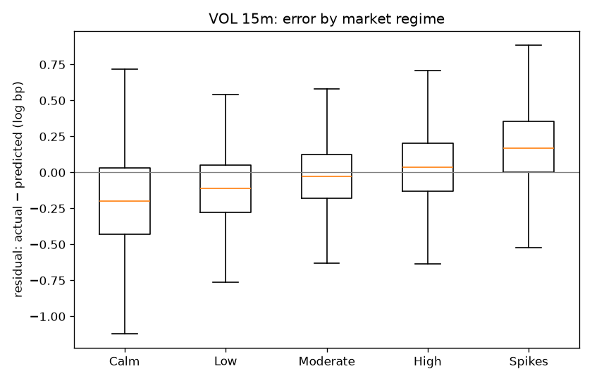

#### Target: `VOL` (30m Horizon)

| Regime | Rows | Range (log bp) | RMSE | MAE | MedAE | Bias (Mean Residual) |
|---|---|---|---|---|---|---|
| Lowest / Calm | 31,031 | [-2.92, 0.64] | 0.3326 | 0.2552 | 0.2091 | -0.1323 |
| Low | 31,030 | [0.64, 0.99] | 0.2353 | 0.1815 | 0.1480 | -0.0891 |
| Moderate | 31,031 | [0.99, 1.29] | 0.2167 | 0.1675 | 0.1369 | -0.0324 |
| High | 31,030 | [1.29, 1.66] | 0.2251 | 0.1748 | 0.1439 | +0.0103 |
| Highest / Spikes | 31,031 | [1.66, 3.78] | 0.3356 | 0.2303 | 0.1587 | +0.1599 |

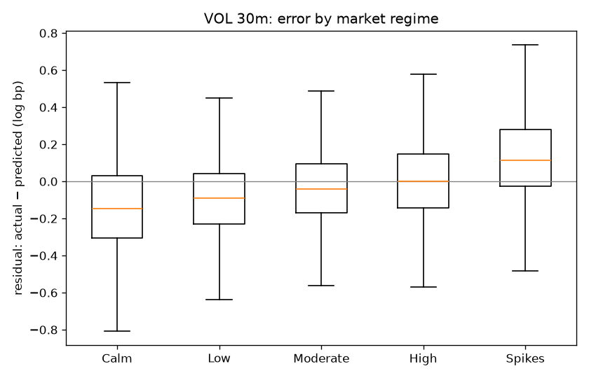

#### Target: `SPREAD` (5m Horizon)

| Regime | Rows | Range (log bp) | RMSE | MAE | MedAE | Bias (Mean Residual) |
|---|---|---|---|---|---|---|
| Lowest / Calm | 80,624 | [-2.77, -1.84] | 0.1602 | 0.1203 | 0.0919 | -0.0639 |
| Low | 80,623 | [-1.84, -1.38] | 0.1464 | 0.1086 | 0.0839 | +0.0287 |
| Moderate | 80,623 | [-1.38, -0.97] | 0.1247 | 0.0859 | 0.0610 | -0.0107 |
| High | 80,623 | [-0.97, -0.32] | 0.1384 | 0.0910 | 0.0633 | +0.0201 |
| Highest / Spikes | 80,623 | [-0.32, 3.75] | 0.1684 | 0.0967 | 0.0538 | +0.0241 |

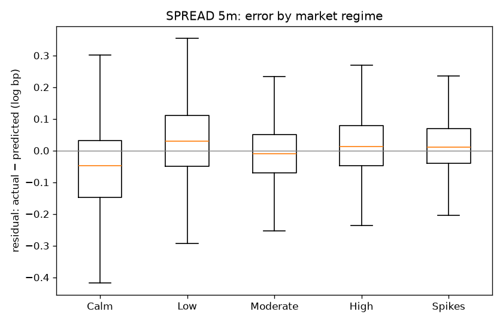

#### Target: `SPREAD` (15m Horizon)

| Regime | Rows | Range (log bp) | RMSE | MAE | MedAE | Bias (Mean Residual) |
|---|---|---|---|---|---|---|
| Lowest / Calm | 78,527 | [-2.70, -1.84] | 0.1147 | 0.0866 | 0.0670 | -0.0401 |
| Low | 78,527 | [-1.84, -1.39] | 0.1179 | 0.0845 | 0.0638 | +0.0115 |
| Moderate | 78,527 | [-1.39, -0.98] | 0.1162 | 0.0774 | 0.0540 | -0.0122 |
| High | 78,527 | [-0.98, -0.33] | 0.1269 | 0.0849 | 0.0580 | +0.0191 |
| Highest / Spikes | 78,527 | [-0.33, 3.69] | 0.1733 | 0.0997 | 0.0492 | +0.0239 |

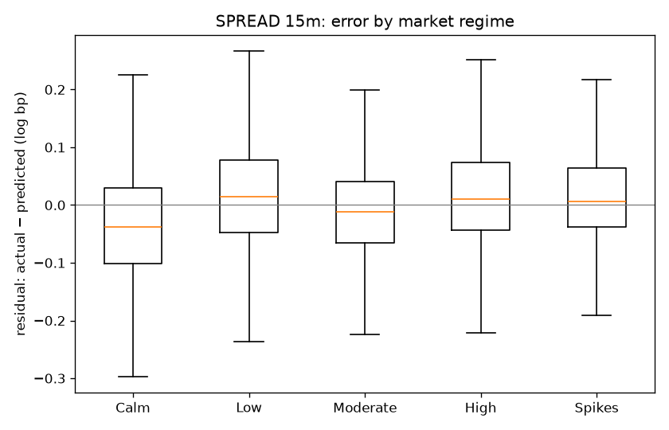

#### Target: `SPREAD` (30m Horizon)

| Regime | Rows | Range (log bp) | RMSE | MAE | MedAE | Bias (Mean Residual) |
|---|---|---|---|---|---|---|
| Lowest / Calm | 76,315 | [-2.53, -1.84] | 0.0944 | 0.0712 | 0.0543 | -0.0298 |
| Low | 76,314 | [-1.84, -1.40] | 0.1082 | 0.0747 | 0.0544 | +0.0055 |
| Moderate | 76,315 | [-1.40, -0.99] | 0.1105 | 0.0735 | 0.0501 | -0.0129 |
| High | 76,314 | [-0.99, -0.35] | 0.1269 | 0.0850 | 0.0547 | +0.0223 |
| Highest / Spikes | 76,315 | [-0.35, 3.45] | 0.1725 | 0.0967 | 0.0441 | +0.0250 |

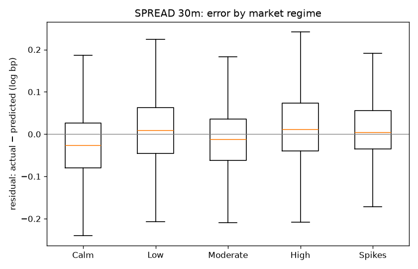

## 5. Top Predictive Features (Share of Gain)

#### Target: `VOL` (5m Horizon)

| Rank | Feature | Gain Share | Tree Splits |
|---|---|---|---|
| 1 | `log_parkinson_30` | 23.13% | 22.0 |
| 2 | `range_mean_15` | 20.57% | 132.0 |
| 3 | `log_ewm_vol_5` | 11.49% | 56.0 |
| 4 | `log_range_30` | 10.20% | 77.0 |
| 5 | `log_ewm_vol_20` | 9.14% | 106.0 |
| 6 | `log_vol_30` | 7.46% | 43.0 |
| 7 | `vol_60` | 7.21% | 56.0 |
| 8 | `log_range_5` | 4.73% | 205.0 |
| 9 | `vol_15` | 0.70% | 33.0 |
| 10 | `y_tod_mean` | 0.70% | 536.0 |
| 11 | `log_ewm_vol_60` | 0.62% | 48.0 |
| 12 | `y_tod_mean_5d` | 0.51% | 138.0 |
| 13 | `log_vol_1440` | 0.30% | 119.0 |
| 14 | `range_bp` | 0.28% | 193.0 |
| 15 | `log_vol_240` | 0.27% | 53.0 |

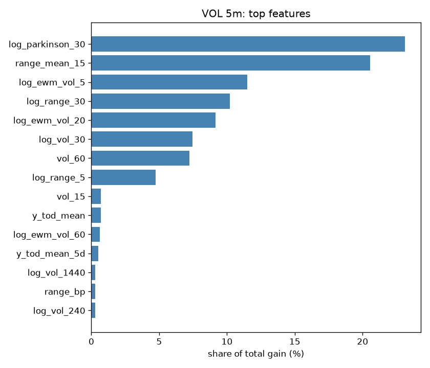

#### Target: `VOL` (15m Horizon)

| Rank | Feature | Gain Share | Tree Splits |
|---|---|---|---|
| 1 | `log_parkinson_30` | 23.57% | 43.0 |
| 2 | `log_ewm_vol_20` | 18.77% | 114.0 |
| 3 | `range_mean_15` | 14.40% | 115.0 |
| 4 | `vol_60` | 11.87% | 44.0 |
| 5 | `log_range_30` | 9.67% | 70.0 |
| 6 | `log_ewm_vol_5` | 5.63% | 37.0 |
| 7 | `log_vol_30` | 4.25% | 46.0 |
| 8 | `log_range_5` | 3.10% | 186.0 |
| 9 | `y_tod_mean` | 1.29% | 490.0 |
| 10 | `range_mean_60` | 1.19% | 57.0 |
| 11 | `y_tod_mean_5d` | 1.09% | 167.0 |
| 12 | `log_ewm_vol_60` | 0.79% | 45.0 |
| 13 | `y_last` | 0.42% | 31.0 |
| 14 | `log_vol_1440` | 0.38% | 172.0 |
| 15 | `log_range_1440` | 0.36% | 144.0 |

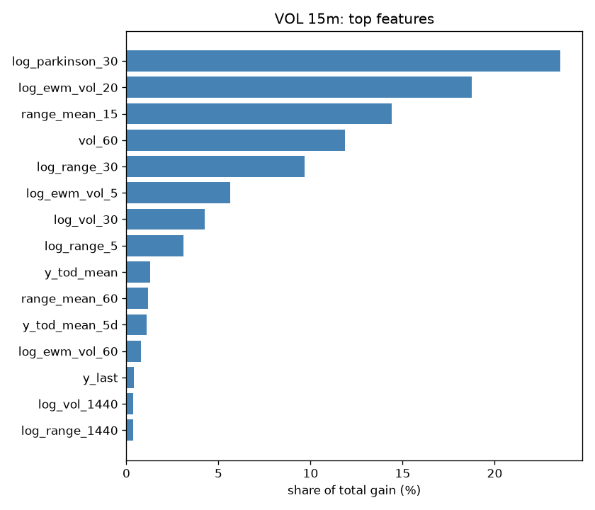

#### Target: `VOL` (30m Horizon)

| Rank | Feature | Gain Share | Tree Splits |
|---|---|---|---|
| 1 | `log_ewm_vol_20` | 24.58% | 89.0 |
| 2 | `log_parkinson_30` | 20.76% | 39.0 |
| 3 | `vol_60` | 13.98% | 35.0 |
| 4 | `range_mean_15` | 9.62% | 93.0 |
| 5 | `log_range_30` | 9.54% | 64.0 |
| 6 | `log_ewm_vol_60` | 6.39% | 48.0 |
| 7 | `y_last` | 4.10% | 30.0 |
| 8 | `log_range_5` | 2.07% | 153.0 |
| 9 | `log_ewm_vol_5` | 1.98% | 22.0 |
| 10 | `y_tod_mean` | 1.55% | 424.0 |
| 11 | `y_tod_mean_5d` | 1.42% | 159.0 |
| 12 | `y_prev_day` | 0.51% | 153.0 |
| 13 | `log_range_1440` | 0.42% | 170.0 |
| 14 | `log_vol_30` | 0.33% | 37.0 |
| 15 | `log_vol_1440` | 0.32% | 190.0 |

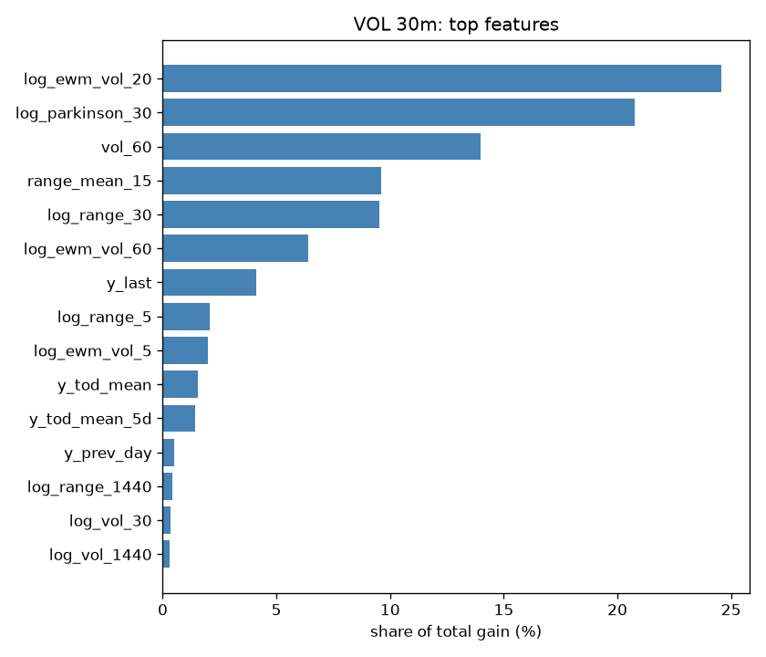

#### Target: `SPREAD` (5m Horizon)

| Rank | Feature | Gain Share | Tree Splits |
|---|---|---|---|
| 1 | `spread_bp` | 30.15% | 422.0 |
| 2 | `spread_mean_15` | 25.54% | 391.0 |
| 3 | `y_last` | 19.88% | 536.0 |
| 4 | `spread_mean_60` | 7.44% | 320.0 |
| 5 | `y_tod_mean_5d` | 6.21% | 296.0 |
| 6 | `y_prev_day` | 5.32% | 143.0 |
| 7 | `y_tod_mean` | 1.96% | 456.0 |
| 8 | `log_ewm_vol_60` | 0.75% | 8.0 |
| 9 | `pair` | 0.73% | 192.0 |
| 10 | `minute_of_hour` | 0.56% | 164.0 |
| 11 | `minute_of_day` | 0.13% | 438.0 |
| 12 | `hour_of_week` | 0.13% | 175.0 |
| 13 | `days_to_settle` | 0.09% | 91.0 |
| 14 | `min_since_gap` | 0.09% | 232.0 |
| 15 | `min_since_roll` | 0.09% | 99.0 |

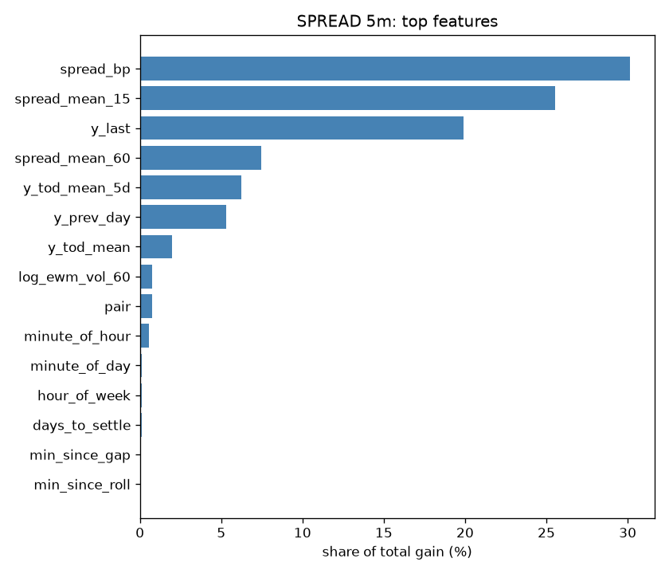

#### Target: `SPREAD` (15m Horizon)

| Rank | Feature | Gain Share | Tree Splits |
|---|---|---|---|
| 1 | `spread_mean_15` | 39.34% | 392.0 |
| 2 | `spread_bp` | 26.35% | 425.0 |
| 3 | `spread_mean_60` | 9.34% | 291.0 |
| 4 | `y_last` | 7.18% | 307.0 |
| 5 | `y_tod_mean_5d` | 6.79% | 316.0 |
| 6 | `y_prev_day` | 4.02% | 204.0 |
| 7 | `y_tod_mean` | 2.16% | 495.0 |
| 8 | `pair` | 1.26% | 170.0 |
| 9 | `minute_of_hour` | 1.02% | 118.0 |
| 10 | `dow` | 0.33% | 30.0 |
| 11 | `minute_of_day` | 0.23% | 499.0 |
| 12 | `hour_of_week` | 0.20% | 209.0 |
| 13 | `log_vol_720` | 0.15% | 28.0 |
| 14 | `log_range_1440` | 0.15% | 86.0 |
| 15 | `log_ewm_vol_20` | 0.14% | 13.0 |

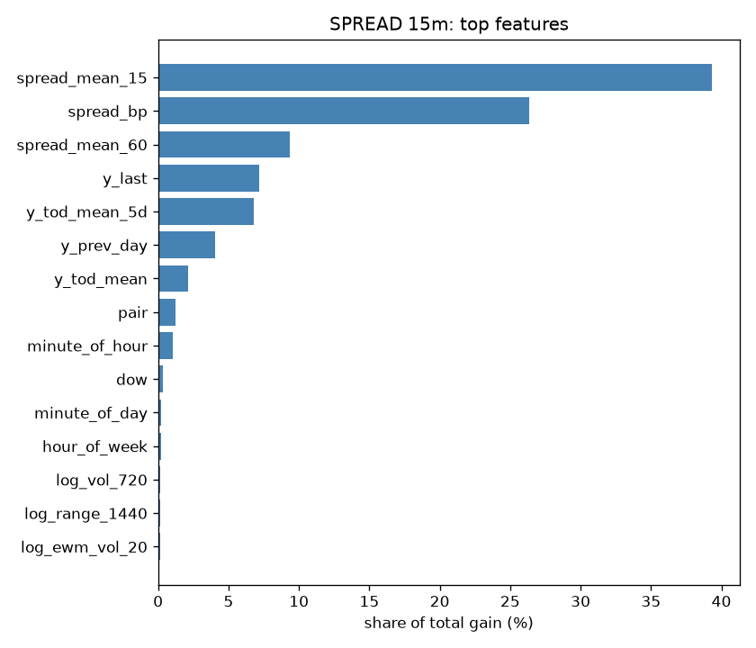

#### Target: `SPREAD` (30m Horizon)

| Rank | Feature | Gain Share | Tree Splits |
|---|---|---|---|
| 1 | `spread_mean_15` | 35.96% | 438.0 |
| 2 | `spread_bp` | 23.27% | 360.0 |
| 3 | `spread_mean_60` | 12.10% | 254.0 |
| 4 | `y_last` | 9.10% | 249.0 |
| 5 | `y_tod_mean_5d` | 7.32% | 289.0 |
| 6 | `y_prev_day` | 3.77% | 258.0 |
| 7 | `y_tod_mean` | 2.76% | 508.0 |
| 8 | `pair` | 1.32% | 188.0 |
| 9 | `flat_share_30` | 0.73% | 7.0 |
| 10 | `minute_of_hour` | 0.49% | 70.0 |
| 11 | `days_to_settle` | 0.36% | 141.0 |
| 12 | `minute_of_day` | 0.31% | 515.0 |
| 13 | `dow` | 0.30% | 47.0 |
| 14 | `hour_of_week` | 0.19% | 241.0 |
| 15 | `log_vol_720` | 0.19% | 28.0 |

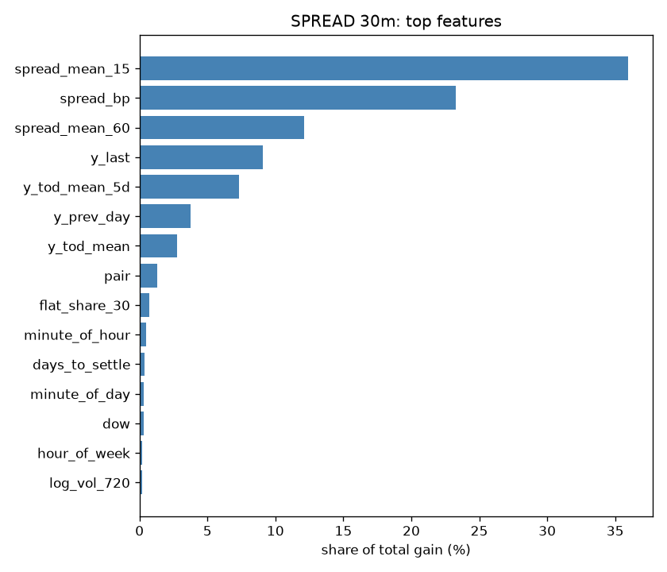

## 6. Walk-Forward Cross-Validation (Time Stability)

Evaluated over rolling out-of-sample time blocks (no lookahead, embargo applied):

### Target: `VOL_30M` Walk-Forward Folds

| fold | test_from | test_to | train_rows | test_rows | xgboost | baseline |
|---|---|---|---|---|---|---|
| 1 | 2026-08-21 | 2026-08-24 | 974,006 | 52,273 | 0.2596 | 0.3817 |
| 2 | 2026-08-25 | 2026-08-27 | 1,026,428 | 77,887 | 0.2629 | 0.3685 |
| 3 | 2026-08-28 | 2026-08-31 | 1,104,279 | 51,321 | 0.2946 | 0.3954 |

**Mean Fold RMSE**: XGBoost = `0.2724`, Baseline = `0.3819` (**+28.67% Improvement**)

### Target: `SPREAD_30M` Walk-Forward Folds

| fold | test_from | test_to | train_rows | test_rows | xgboost | baseline |
|---|---|---|---|---|---|---|
| 1 | 2026-08-21 | 2026-08-24 | 2,337,002 | 126,679 | 0.1428 | 0.3807 |
| 2 | 2026-08-25 | 2026-08-27 | 2,463,901 | 187,431 | 0.1102 | 0.3024 |
| 3 | 2026-08-28 | 2026-08-31 | 2,651,585 | 123,862 | 0.1437 | 0.3530 |

**Mean Fold RMSE**: XGBoost = `0.1322`, Baseline = `0.3454` (**+61.72% Improvement**)
